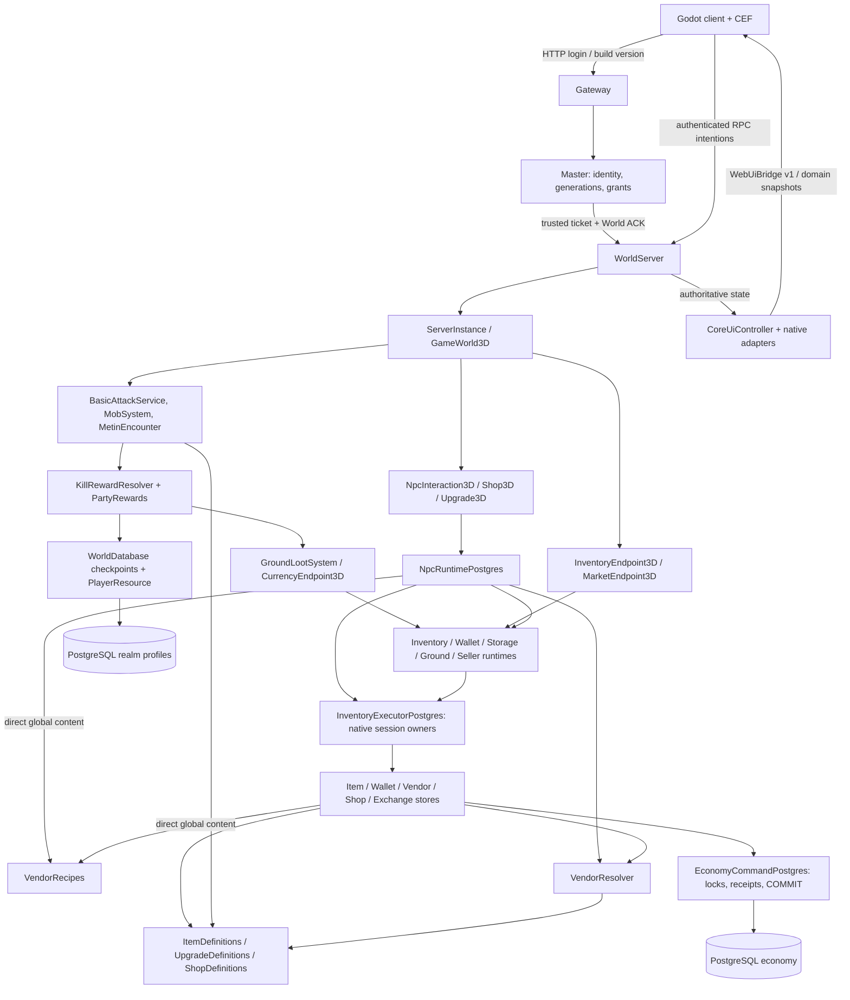

# Gameplay Modularization Audit V1

**Status:** audyt i propozycja do review; nie wdrożony ruleset ani przyjęty kontrakt.
**Baza:** `main`, `de8774741d958f6ed4ec836801ea3c7b5129f96d` (PR #126), 2026-10-23.
**Metoda:** statyczny przegląd kompozycji World3D, persystencji, klienta,
konfiguracji i testów. Wyniki uruchomionych kontroli są w PR. Nie wykonano
porównania z oryginalnym serwerem Metin2 ani testu przełączenia profili — taki
mechanizm jeszcze nie istnieje. „Classic” oznacza proponowanego właściciela
reguł, nie potwierdzoną zgodność obecnych liczb i zachowań z Metin2.

## 1. Wniosek i aktualne zależności

**Nie potrzeba drugiego Inventory ani drugiego silnika ekonomii.** Najtańszy
pierwszy moduł to Vendor Recipes: `VendorResolver.resolve()` już przyjmuje
receptury i pule jako argumenty. Z `[]` i `{}` wykonuje zwykłą wycenę Yang.
Brakuje właściciela wyboru polityki, spójnego przekazania jej do workera i klienta
oraz testów zmiany profilu. Boolean w CEF nie rozwiązuje tych problemów.

Pełny Classic jest znacznie droższy niż wyłączenie receptur: progresja, Warrior,
reward rights, wyposażenie i prezentacja mają niezależne założenia. System
3 prefixów/3 suffixów nie jest dziś działającym generatorem. Masteries są
zachowanymi danymi legacy bez aktywnego runtime. Nie należy planować ich
„wydzielenia” tak, jakby były skończonymi mechanikami.



Źródła kompozycji: [WorldMain][C1], [PG bootstrap][C2], [GameWorld3D][C3],
[MandateWorldServices][C4], [WorldServer][C5], [CoreUiController][U1].
`MandateWorldServices` udostępnia istniejących właścicieli i sesje; nie jest
kontenerem reguł. Nazwa „Mandate” nie oznacza, że jego cała zawartość jest opcjonalna.
`MarketplaceService` obsługuje głównie ścieżkę SQLite/reference; aktywny PG korzysta
z `seller_runtime_postgres.gd` i session/store. Nie opierać refaktoru wyłącznie
na nazwach klas i starych komentarzach „opt-in”.

## 2. Macierz odpowiedzialności i koszt

Koszt dotyczy granic i testów, nie estymaty godzin. **Mały:** jedna domena
(zwykle jeden PR). **Średni:** kilka właścicieli i klient–worker–store (2–3 małe
PR-y). **Duży:** zmiana znaczenia danych, combat lub nieportowany legacy;
estymata implementacji wymaga najpierw decyzji gameplayowych.

| System / aktualny stan | Shared Core | Classic Ruleset — docelowo | Mandate Extensions / aktualne sprzężenie | Wyłączenie dziś; koszt / ryzyko |
|---|---|---|---|---|
| Inventory, ItemInstance — działa | UID, custody, revisions, locks, receipts, recovery | Siatka, stack limits, sloty, użycie | Globalne definicje i affixy w store'ach | Nie wyłączać core; parametry średnie / wysokie dla starych footprintów |
| Equipment — działa, głównie broń | Atomic equip/unequip, projekcja i invalidacja | Slot–item–klasa, wymagania i skale | Obecny balans broni, debug sword override | Brak profilu; średnie / wysokie |
| Affixy — ograniczone | Lista rolli i indeks wyszukiwania | Osobno ustalona polityka bonusów | 3+3/rarity w tooltipie; brak generatora | Można zatrzymać generowanie, nie odczyt starych rolli; generator to nowe duże zadanie |
| NPC Shop — działa | NPC/service/range, payment+item+receipt | Katalog, ceny Yang, stock policy | Statyczny katalog/content IDs | Resource seam; małe/średnie, recovery pozostaje |
| Vendor Sell/Recipes — działa | Quote, atomowe inputy/rewards/Wallet, receipts | Zwykła sprzedaż za Yang | Globalne VendorRecipes w runtime i store | Brak config gate; małe wydzielenie, średni pełny profil / wysokie ekonomiczne |
| Upgrade — ograniczone +0→+1 | Atomic material/item/Yang i replay | Poziomy, materiały, szansa/porażka | Validator tylko 0→1/100% | Resource seam; pełny Classic średnie/duże |
| Player Shops — działa | Shop/claims custody, settlement, revenue | Model dostępnego handlu | Price-free offers i claimable Yang | Brak kompletnego gate; średnie/wysokie, claims muszą pozostać |
| Exchange — działa | Ledger, reservations, atomic matching | Klasyfikacja wymaga decyzji | Obecne aktywa/orderbook/UI | Constructor flags, bootstrap zawsze on; średnie/wysokie dla orderów |
| Auction — działa | Async reader, admission, indeksy | Zakres wyszukiwania | Katalog affixów i aktywów | Reader można odłączyć, brak gameplay gate; małe/średnie |
| Storage — działa | Account custody, original issuer recovery | Dostęp usługi i pojemność | Współdzielenie ze źródłami Exchange | Osobny runtime, ale nie niezależne zapisy; średnie/wysokie |
| Stats/XP — działa | Checkpoint, spend receipt, revision, cache | Krzywa EXP i współczynniki klas | 70×level, brak capu inwestycji, Warrior matrix | Nie samym configiem; duże/wysokie dla danych |
| Masteries/active skills — legacy/brak pełnego slice | Zachowanie payloadów | Docelowe klasy/skille | Stare category/capacity/loadout | Nie reklamować jako gotowego modułu; projekt i port duże |
| Combat/AI — działa | Auth hit/input, lifecycle, replikacja | Damage, combo, reakcje, AI/content | Warrior traces/advance, horn taunt, balans | Są resources/resolvery; pełny profil duży/wysokie feel |
| Party — działa | Identity/RAM, session/instance qualification | Członkostwo i podział nagród | Carry, tryby dropu, shared encounter policy | Czyste strategie już są; całe off dotyka Chat/loot; średnie |
| Chat — działa | Auth, delivery, dedup, block, limity | Kanały i odbiorcy | General/trade na proces, party dependency | Guild unavailable; brak capabilities; małe/średnie |
| Questy/dailies — legacy w World3D | Zachowanie profilu, generic auth | Cele i reward policy | Wardstones, templates, legacy Inventory gold | Brak pełnego portu PG; duże przy reaktywacji |
| Loot/Metiny — działa | Jeden UID, pickup receipt, expiry, Wallet | Tabele, prawa do puli, encounter content | Luck, events, damage-weighted shared drops | Data/resolver seams, brak profilu; średnie/wysokie |
| CEF — działa | Window/drag/bridge, journal transport | Render server state | 3+3, rarity, cztery staty, mode lists | Ukrycie UI nie wyłącza reguł; średnie |
| Config/PG — działa infrastruktura | Startup, authority, schema/session versions | Wybór wersji reguł | Brak gameplay profile/capability snapshot | „Classic” w nazwie to etykieta; średnie, dane wysokie |

## 3. Mechaniki: pliki, sprzężenia, seamy i pokrycie

### 3.1 Inventory, Equipment, ItemDefinition, ItemInstance

- [ItemDefinition][I1] łączy footprint/presentation z zasadami: `primary_action`,
  `equipment_slot`, `stack_limit`, `tradeable`, `market_fungible`, `base_stats`,
  `stats_per_upgrade`, `vendor_price`, `recipe_tags/category`. To wspólna definicja
  danych, nie powód do stworzenia alternatywnej klasy lub tabel dla Classic.
- [ItemInstance][I2] przechowuje UID, amount, upgrade, affixes, sockets, revision.
  `effective_stats()` dodaje upgrade i affixy **tylko do kluczy base_stats**.
  To reguła interpretacji, nie neutralna serializacja. Nowy bonus nie zacznie
  działać tylko dzięki dopisaniu nowego klucza w JSON.
- [ItemDefinitions][I3] jest statycznym registry współdzielonym przez store'y,
  Exchange, Auction i klienta. Usunięcie definicji „wyłączonego modułu” może
  zablokować cały Inventory (`unknown_definition`), nie tylko ukryć item.
- [InventoryGrid][I4]: 5×9×4 i wysokości 1–3. [PG ItemStore][I5] oblicza pojemność
  z aktualnych definicji, inicjalizuje testowe miecze, składa equipment stats
  i ma specjalny override `dev_trace_sword`. [InventoryEndpoint3D][I6] publikuje
  committed zmiany i projekcje. UI Equipment skupia się na broni; nie ma pełnego
  Classic modelu slotów, klas i wymagań. PG `PrimaryAction.USE` daje `unsupported`.
- Seam: parametry definicji i kalkulacja statów; custody i zapis pozostają we
  wspólnej transakcji. Hotbar USE-only jest kontraktem, nie gotowymi consumables.
- Testy: `item_instances`, `inventory_grid`, `ground_items`, `items_session`,
  `postgres_inventory*`, `stats_v1`, `hotbar_network`. Brak zmiany profilu contentu,
  footprint/stack migracji i jednoznacznej polityki unknown stat/definition.

### 3.2 Prefixy, suffixy, generator i persystencja

- Durable format: lista `{stat,value}` w `affixes_json`. `ItemInstance.from_row()`
  sprawdza format i liczby, nie rodzaj prefix/suffix. [GroundLootSystem][L1]
  ogranicza listę do sześciu i wymaga stat key obecnego w base_stats; nie egzekwuje 3+3.
- [LootResolver][L2] i `WorldEventDropService` zwracają obecnie puste affixy.
  Test arena i Metin reward przez [KillRewardResolver][L3]/[PartyRewards][P2]
  generują pojedynczy `attack` 1–9. W `source/` nie znaleziono produkcyjnego
  generatora prefix/suffix, tierów, wag lub konfliktów rodzin affixów.
- [ItemUiAdapter.tooltip_details][U2] nie wymyśla `kind`. [TS tooltip model][U3]
  akceptuje brak rodzaju, ogranicza sklasyfikowane prefixy/suffixy do 3+3 i mapuje
  liczbę affixów na normal/magic/rare/legendary. Dev preview pokazuje przykłady 3+3.
- [Auction schema][E5] utrzymuje indeks `(uid,ordinal,stat_id,value)` triggerem.
  [ItemAffixLabels][I7] steruje etykietami i filtrami. [Exchange ledger][E4]
  odrzuca affixy/sockets/upgrade jako niefungible.
- Wyłączenie przyszłego modułu zatrzymuje **generowanie**, nie czytanie/custody
  istniejących itemów. Czy stare bonusy działają w Classic, wymaga decyzji designu;
  nie można ich cicho usuwać/ignorować podczas loginu.
- Testy: `ground_items`, `item_instances`, `loot_resolver`,
  `postgres_auction_search`, `test/item_tooltip.test.mts`. Brak generatora oznacza
  brak testów jego rozkładu/3+3 durable/tier migration — to przyszłe nowe funkcje.

### 3.3 NPC Shop, Sell, Recipes, Upgrade

- [ShopDefinition][N1]/`ShopOfferDefinition` i [NpcServiceDefinition][N2] są danymi.
  `Shop3D._authorization()` sprawdza bieżący NPC/service/range i registry;
  PG runtime korzysta ze wspólnych właścicieli Inventory/Wallet.
- [VendorResolver][V1] to deterministyczne matching/wycena bez SQL/RPC/RNG.
  Sortowanie UID/priority/recipe ID oddziela wynik od drag order.
  `vendor_price < 0` zabrania także udziału w recepturze. Tags/category są
  metadata Mandate; ich obecność nie musi wymuszać włączenia recipes.
- [VendorRecipes][V2] to globalny preload registry. Pięć ksiąg (także duplikaty)
  daje jeden losowy book z puli pięciu; pełne zestawy powtarzają recipe, reszta Yang.
  Obecne book items nie implementują nauki skilli.
- Bezpośrednie sprzężenie: [NpcRuntime.quote][V3] oraz [VendorSellStore][V4]
  (`version`, ponowne `resolve`, losowanie z `pools`). [NpcSession.execute][V5]
  tworzy store w workerze. Wstrzyknięcie reguł tylko w mapę nie dotrze do transakcji.
- [UpgradeDefinition.validation_errors][N3] wymusza 0→1 i 100%, registry ma tylko
  BASIC. [UpgradeStore][N4] już kopiuje server-owned recipe na pełną próbę
  transakcji. To seam, ale poziomy >1, porażka/zniszczenie i Classic materiały
  wymagają osobnego projektu, nie tylko podmiany `.tres`.
- Testy: `vendor_recipes`, `vendor_ui`, `postgres_vendor_sell/ui`,
  `postgres_npc_runtime`, `shop_purchase`, `upgrade_transaction`,
  `shop_network`, `upgrade_network`, browser preview. Są rollback, conflicts,
  capacity, stale i recovery; **brak rzeczywistego przełączenia rulesetu**.

### 3.4 Player Shops, Exchange, Auction, Storage

- PG delivery: [SellerRuntime][E1] → `seller_session_postgres.gd` →
  `shop_seller_postgres.gd`, `shop_settlement_postgres.gd`,
  `account_claim_postgres.gd`, [ExchangeLedger][E4], `exchange_orders_postgres.gd`.
  Wspólny [EconomyCommand][E2] posiada account locks, session fencing,
  request fingerprint, receipt i COMMIT; Wallet/ItemStore są współdzielone.
- Konstruktor SellerRuntime ma już `exchange_ledger`, `exchange_matching`,
  `auction_search`, ale [bootstrap][C2] przekazuje `true,true,true`. To opcje
  kompozycji, nie kompletny kontrakt wyłączenia działającej ekonomii.
- Exchange także modyfikuje account Storage; wyłączenie jego okna nie odcina tych
  zapisów. Zakaz nowych orderów nie może blokować cancel/refund, claims, receipts
  i uzgodnienia istniejących rezerwacji. To samo dotyczy offline Shop settlement.
- `MarketRequestRules`/ItemDefinitions określają tradeability/fungibility/aktywa.
  `AuctionQueryService`, `auction_runtime_postgres.gd`, `AuctionSearchContract`
  posiadają read scheduling/admission, a nie alternatywny transaction engine.
- Price-free listings, osobne claimable sale revenue i Exchange są obecnymi
  zasadami prototypu, nie udowodnionymi zasadami Classic. Sama dostępność usługi
  może stać się capability, lecz settlement musi zachować dotychczasowe invarianty.
- Testy: `postgres_shop_seller/settlement`, `postgres_settlement_runtime`,
  `postgres_exchange_ledger/orders/runtime`, `postgres_matching_runtime`,
  `postgres_storage_runtime`, `postgres_auction_runtime/search`, workload/soak.
  Brak feature-disable z otwartymi orderami/ofertami i recovery w nowym profilu.

### 3.5 Stats, Progression, XP, Masteries

- [PlayerResource][S1]: `70 * level`, progi 25/50/75% → punkty atrybutów,
  100% → level i skill point, bez dodatkowych trzech punktów przy awansie.
  Brak capu inwestycji; `HEALTH_PER_LEVEL=5`. To fakty prototypu, nie potwierdzona
  krzywa Classic. `stats_version=1` to format/migracja, nie wersja całej gry.
- [AttributeMap][S2] ma macierz Warrior i `weighted()`/opcjonalny argument profile.
  Główne wywołania używają domyślnego Warrior; brak wyboru klas/profilu w startup.
  WorldServer składa equipment/atrybuty/buffy w projekcję z jawnymi refreshami,
  nie przelicza pełnych statów per physics tick. To infrastruktura do zachowania.
- [CharacterStatsService][S3], [Stats schema][S4], profile store oraz
  `WorldDatabase.award_experience/checkpoint_progression` rozdzielają immediate
  spend+receipt od soft XP checkpoint. Migracja starego payloadu refunduje sześć
  atrybutów i inicjalizuje milestone marker bez retroaktywnych nagród.
- Masteries/loadout są odczytywane przez `PlayerProfileCodec` i zapisywane
  w `mastery_json` przez WorldStorePostgres. `WeaponItem.category/capacity`
  i EquipmentComponent to legacy Player/2D, bez podpięcia do aktywnego Warrior
  pipeline. Skill points są zapisywane; nie ma pełnego active-skill slice.
- Zmiana curve/limitów wymaga jawnej strategii EXP, spent/unspent points,
  milestone marker i skill points. Nie używać ponownie migracji v0→v1 jako
  przełącznika profilu. Nie ustalać teraz alternatywnego balansu.
- Testy: `stats_v1`, `stats_network`, `stats_ui_network`, `progression_checkpoint`,
  PG `full-state`, Party EXP. Brak migracji między krzywymi/klasami/rulesetami;
  Masteries i skille wymagają osobnego acceptance contract przed implementacją.

### 3.6 Combat, umiejętności, AI

- [BasicAttackService][B1] posiada RAM orchestration sequence/input, queue,
  timing, hit/reakcje i movement unlock. [BasicAttackCombos][B2] wybiera tylko
  `onehand_sword` i zasoby 4/5/6-step na podstawie combo state.
  `BasicAttackStepDefinition`, `CombatTrace`, `HitReactionResolver/Profile` są
  wąskimi seamami; animacja nie autoryzuje damage.
- PlayerCombatRuntime, PlayerActor3D, BasicAttackHits i WarriorVisual3D
  współdzielą klucze/timingi/advance. Zmiana rulesetu musi zachować zgodność
  prezentacji, nie tylko inną liczbę attack w store. Aktualny feel jest balansem gry.
- [MobSystem][B3] używa MobDefinition/MobDefinitions/MobSpawnEntry; canonical
  registration chroni przed odmiennym max HP u klienta. AI/wander/leash/aggro
  to runtime, HP/damage/speed/loot-roll-count to content. [MetinEncounter][B4]
  jest osobnym encounterem, lecz zna `FirstRegionGraybox.METIN_POINTS`
  i prototype reward. Nie jest gotowym generic boss API.
- Horn taunt jest działającą osobną akcją, nie pełnym systemem klasowych skilli.
  Legacy `action.perform` czyta `players_by_peer_id`/Weapon; to nie aktywna
  ścieżka basic attack World3D. PG item USE daje unsupported.
- Najpierw wybierać data/policy w istniejących resolverach; nie wymieniać
  całego pipeline'u na framework. Brak SQL/network per hit pozostaje invariantem.
- Testy: `combat_feel`, `combat_feel_v2`, `combat_trace`, `hit_reactions`,
  `mob_packs`, `horn_taunt`, `combat_trace_network`, `metin_network`, `pve_session`.
  Brak combat-profile i manifest mismatch testów. Headless nie dowodzi podobieństwa feel.

### 3.7 Party, Chat, questy, loot

- [PartyService][P1] jest ownerem World Process: character ID, osiem slotów,
  gap ≤15 przy join, offline bez deadline, lider offline zachowuje przywództwo.
  `party_exp.gd`/`party_drop.gd` są już czystymi strategiami. Carry ma jedną
  funkcję wag; podział zachowuje sumę EXP/Yang. Dobry wzorzec lokalnego seamu.
- [PartyRewards][P2] i claims snapshot przy pierwszym trafieniu zachowują
  członkostwo/tryby dla wkładu. Zwykły mob wybiera konkurenta; boss/Metin
  kwalifikuje konkurentów z ≥10% damage, a pojedynczy drop losuje proporcjonalnie
  do wkładu. Próg nie gwarantuje itemu. Nie przełączać Party w trakcie walki.
- [WorldChat][P3]: dedup przed limiterem, local same-instance/radius,
  general/trade na proces, whisper online, PartyService jako zależność kanału.
  Guild zwraca `guild_unavailable`. Istnienie `realm.messages` nie dowodzi,
  że ephemeral Chat V1 korzysta z persistent legacy chat store.
- Quest handlers są na literal allowliście WorldServer, ale oczekują najczęściej
  `players_by_peer_id` i `instance_map.get_quest_giver()`. [ServerInstance][C6]
  opisuje je jako legacy bridge, nie normalny stan 3D. [QuestService][Q1]
  wypłaca stare Inventory item IDs i `Economy.gold_id()`, nie PG UID/Wallet.
  `backfill_wardstones()` jest wywoływany przy auth: nie wszystko jest martwe,
  ale nie ma pełnego bezpiecznego portu quest rewards do Economy V2.
  Nie reaktywować tego configiem ani usuwać zachowanych payloadów bez migracji.
- Loot seamy: LootTable/LootEntry/LootContent, [LootResolver][L2] i event service.
  Selection, rights, ground UID i pickup są rozdzielone. Yang, XP, Luck i events
  mają osobne zasady. `CurrencyEndpoint3D.DOG_YANG` i miecz Metina to konkretne
  twarde reguły do późniejszego wyniesienia, nie transaction engine.
- Testy: `party_v1/network`, `chat_v1/network`, `loot_resolver`,
  `world_event_drops`, `ground_items`, `metin_encounter/network`,
  `postgres_ground_runtime`. Brak end-to-end World3D quest accept→kill→turn-in→PG
  reward. Wyłączenie Party wymaga też polityki kanału Chat i nagród, nie ukrycia UI.

### 3.8 CEF i zależności od mechanik

- [CoreUiController][U1] tworzy konkretne adaptery; [UiCommandDispatcher][U4]
  ma literalną listę domen. [WebUiBridge][U5] posiada version=1, walidatory,
  korelację i generację transportu. `ui.snapshot` jest naturalnym istniejącym
  miejscem nowej domeny, lecz **gameplay capabilities dziś nie ma**.
- [TS composition][U6] montuje widoki konkretnych mechanik. QuickItemTargets
  wybiera ostatnie otwarte okno i nie powinien wybierać wyłączonego modułu.
  Sell renderuje server quote Yang/rewards; nie matching ani RNG w produkcyjnym CEF.
- Mechaniczne założenia pozostają w tooltip rarity/3+3, kluczach czterech statów,
  mode lists Party, przyciskach usług i hotbar USE-only. Capability ogranicza
  kontrolki, nie przesyła kodu i nie zamienia przeglądarki w rule engine.
- Native adapter, endpoint i store muszą odrzucać niedozwolone **nowe** intencje
  niezależnie od DOM. Journal i receipt recovery pozostają dostępne także przy
  wyłączonej funkcji tworzenia nowych ofert. Reload dostaje pełny bieżący stan.
- Testy: Web UI contracts, tooltip/vendor tests, real-browser preview,
  native network/export fixtures. Brak capability-disabled, hostile-JS command
  i reconnect-to-other-profile scenariuszy. Headless nie certyfikuje fizycznego inputu.

### 3.9 Konfiguracja World/Master/Gateway i synchronizacja

- [WorldMain][C1] ładuje world info i budgets z `data/config`; [Limits][C7]
  waliduje immutable settings i odrzuca nieznane klucze. `name="Classic"`,
  `pvp`, `hardcore`, `bonus_xp` nie wybierają kompletnego rulesetu.
  Brak profilu modułów sterującego badanymi ścieżkami; nazwa świata to nie gate.
- [Master][C8] ma identity/backend/authority/grant/ACK/capacity checks;
  [Gateway][C9] porównuje dokładny build klienta i serwera. To zgodność wydania,
  nie reguł/contentu. [WorldManagerClient][C10] raportuje world info/backend/
  authority bez gameplay manifestu. ContentRegistryHub/PathRegistry versions
  dotyczą indeksu contentu/sync paths, nie możliwości profilu.
- Docelowo World rozwiązuje profil raz przed serving; Master przyjmuje zaufany,
  obsługiwany manifest i podaje bezpieczny opis świata. Gateway nie utrzymuje
  własnej listy receptur. Jeden owner reguł, nie trzy niezależne configi.
- Testy: `runtime_capacity`, `account_identity_session`, `master_entry_attempts`,
  `world_session_admission`, `world_rpc_admission`, PG process/full-state.
  Brak odmowy rozbieżnego gameplay manifestu przed wydaniem biletu.

### 3.10 Migracje PG i zgodność danych

- [EconomySchema][D1]/[RealmSchema][D2] provisionują offline; [Preflight][D3]
  sprawdza feature schema versions i economy authority. Stats mają własny feature.
  Brak durable active gameplay profile. `world_profile_id` to binding danych
  profilu postaci i economy, **nie ruleset**.
- Zmiana profilu nie uzasadnia resetu UID, authority, receipts, Wallet ani
  przełączenia backendu. PG failure nie pozwala na SQLite fallback.
  Rozszerzalny JSON nie dowodzi zgodności znaczeń: staty, footprint i ceny
  nadal zależą od obecnego contentu.
- [Persistence policy](persistence-policy.md) opisuje soft XP (~60s), Yang (~30s)
  i immediate economic COMMIT. Tabela Party ma pozostałość „120-second reconnect
  grace”; źródło PartyService/testy mają offline bez limitu. Audyt przyjmuje kod,
  nie proponuje przywracania TTL ani migracji Party.
- Testy PG: preflight/bootstrap/full-state/commit_failure/maintenance/backup,
  Inventory/session races, stress i representative. Nie obejmują semantyki
  różnych profili. W audycie nie wykonujemy importów/resetów danych gracza.

## 4. Docelowy model konfiguracji i kompozycji — propozycja

1. **Shared Core:** session/auth, PG, UID/custody, Inventory, Wallet, locks,
   receipts, retry/recovery, workerzy, committed-state publication i CEF primitives.
   Moduł reguł nie wykonuje SQL/RPC i nie zastępuje Inventory.
2. **Base rules:** ceny, EXP, klasowe skale, sloty, dostępne akcje gameplay.
   Pozostają w bieżących domenach; wydzielenie nie wymaga przenosin katalogów.
3. **Extensions:** wąskie wkłady do istniejących polityk, np. receptury i pule.
   Jeden jawny composition root rejestruje je przed startem MapInstance/workerów.

Minimalny immutable `GameplayRules` (nazwa robocza) wiąże preset ID, wersje
polityk, zweryfikowany content i capability manifest. Bez reflection, skanowania
skryptów, dynamic code loading, event busa i DI frameworka. Na początek tylko
Vendor ma rzeczywisty nowy seam, nie interfejs do każdej klasy.

Proponowany config, **jeszcze nieobsługiwany**:

```ini
[gameplay]
version=1
profile="prototype_v1"
```

Jawne presety w kodzie startowym: `prototype_v1` zachowuje obecną grę z Recipes;
`prototype_no_vendor_recipes_v1` zmienia tylko tę politykę. Dopiero po decyzji
designu powstaje `classic_v1`. Sam wariant bez receptur nie jest „wiernym Classic”.
Wewnętrzny preset wskazuje bazę i listę modułów, np. `[vendor_recipes_v1]`;
bez drugiego niezależnego configu booleanów o sprzecznych wartościach.
Nieznany preset/module, duplikat, konflikt lub niepoprawny content → odmowa startu.
**Brak hot reload V1:** przełączenie wymaga kontrolowanego drain/restart.

### Wersje i tożsamości nie są zamienne

| Wersja/tożsamość | Znaczenie |
|---|---|
| Build version / RPC layout | Obecna zgodność wydania klient/serwer |
| PG feature schema version | Format tabel i invarianty SQL |
| `stats_version` | Interpretacja progression payload i migracji |
| Item/wallet revision, projection generation | Kolejność konkretnych zmian i snapshotów |
| Economy authority / `world_profile_id` | Tożsamość i binding danych, nie balans |
| Nowy `rules_id` / vendor fingerprint | Semantyka wyceny i jej content |
| Capability schema version | Format bezpiecznej listy dostępnych akcji |

Fingerprint Vendor obejmuje **semantyczną wersję algorytmu**, ceny/sell eligibility,
receptury/priority/requirements, pule/quantity/RNG policy i content wpływający
na przyjęcie nagrody (stack/footprint). Serializacja musi mieć stabilny porządek
kluczy/rejestrów. Zmiana matching/RNG code wymaga świadomego bumpu algorytmu.
Dzisiejszy `VendorRecipes.version()` hashuje `[1,pools,...recipes,...items]`,
nie pełny kod. Zachować ochronę content hash, nie zastąpić jej booleanem.

### Capability snapshot

Zaufany przepływ: server GameplayRules → World session snapshot → native adapter
→ nowa domena CEF w istniejącym `ui.snapshot`/domain updates. Pola:
`schema_version`, `profile_id`, stabilne `rules_id`, dostępne nowe akcje.
Bez ukrytych receptur, SQL i polegania na local storage/configu przeglądarki.

- Dopiero poprawny znany snapshot aktywuje nowe akcje; unknown format fail-closed.
  Recovery starych poleceń pozostaje dostępne niezależnie.
- Server sprawdza aktywną politykę przy admission i w transakcji, nie listę
  capabilities przesłaną przez klienta. UI nadal tylko renderuje quote.
- Zmiana World/profilu usuwa transient quote i stare generations; scoped journal
  zachowuje oryginalny command ID/payload do read-only receipt lookup.
- Master zna zaufany, obsługiwany manifest; Gateway tylko safe roster/build gate.
  Przy przyszłych wielu Worldach jedna authority nie może mieć różnych zasad
  mutacji bez jawnego kontraktu. Nie projektujemy tu multi-World hosting.
- Nowa domena wymaga zgodnego native/TS validation i wydania wg RPC policy.
  Audyt nie modyfikuje obecnego protokołu.

## 5. Vendor Recipes — szczegółowy plan wydzielenia

### Jeden resolver, jedna transakcja

`VendorRules` dostarcza immutable, zweryfikowane `recipes`, `pools`, `fingerprint`.
Classic-style Sell przekazuje puste listy/pule; rozszerzony Sell obecne definicje.
`VendorResolver.resolve()` zachowuje wynik `yang/rewards/recipes` i nie losuje
podczas quote. Nie powstaje ClassicVendorStore, drugi journal, osobny Sell
endpoint ani inny model custody.

World dostaje politykę w konstruktorze NPC runtime z bootstrapu. Worker ma tę samą
zamrożoną politykę jako kopię primitive manifest data albo buduje ją raz ze
znanego server preset ID. **Nie przekazywać żywych node'ów i mutowalnych shared
Resource'ów między wątkami.** Worker ma własny aktywny fingerprint; ciało joba
nie może wybierać historycznego profilu i zalegalizować starej operacji.
Quote i worker potwierdzają identyczny manifest przed admission.

Konkretny łańcuch zmian: [bootstrap][C2] → [executor][V6] → [NPC session][V5]
→ [Vendor store][V4] oraz [NpcRuntime.quote][V3]. To około pięciu istniejących
miejsc kompozycji/wykonania, nie przebudowa wszystkich persistence store'ów.

### Quote ≠ receipt

**Dziś:** jedna quote na konto w RAM NPC runtime, TTL 30s, związana z economic
context, NPC/service (namespace NPC zawiera instancję), UID/revision/amount,
planem i wersją. Restart gubi quote, ale nie `economy.market_commands`.
VendorSellStore po session/account admission sprawdza receipt przed TTL, wersją,
custody i RNG. Request fingerprint to `[owner,quote_id,npc,service,version,lines]`.
Publiczny `sell` runtime najpierw wymaga trzymanej quote. Po restarcie właściwą
ścieżką jest **`receipt`**, nie ponowne wysłanie starego `sell` z samym quote ID.

**Po wydzieleniu:**

1. Fresh quote korzysta tylko z aktywnej server policy. Nie rezerwuje custody,
   nie zapisuje itemów/Wallet, nie losuje reward book/UID.
2. Execute po account/session fencing szuka receiptu; następnie expiry,
   fingerprint aktywnej policy workera, aktualne inputy, plan, miejsce i środki.
   Dopiero potem consume/RNG/reward. Recovery nie jest nową mutacją.
3. Zmiana zasad/ceny/puli/algorytmu daje `quote_stale`; nie przeliczać automatycznie
   i wykonywać po innej cenie. Nowy wynik wymaga świeżej, jawnej akceptacji.
   Odmowa nie zmienia żadnego UID/amount/revision/Yang.
4. Ta sama transakcja nadal zużywa inputs, uwzględnia captured pending Yang,
   tworzy reward UID i pełny receipt, następnie COMMIT. Błąd dowolnego kroku
   rollbackuje całość. RNG jest wyłącznie w tej transakcji.
5. Receipt nie wymaga aktywnych receptur, starego NPC ani ważności quote.
   Wymaga aktualnego autoryzowanego konta i oryginalnego issuera/command ID
   według istniejącego kontraktu. Nie liczy ponownie planu i nie uruchamia RNG.
6. Zachować zgodność request fingerprintu starych receipts. Najmniejszy zakres:
   ten sam shape i pole `version` zawierające pełny fingerprint nowej polityki.
   Lookup starego `result_json` nie musi ładować historycznych reguł.

### Restart i przełączenie profilu

| Sytuacja | Wymagane zachowanie |
|---|---|
| Quote A niewysłana, profil A→B | Quote znika/nie pasuje. Fresh quote B + jawny accept, zero mutacji |
| Restart z identyczną policy | Stary quote ID nadal nieważny (RAM-only); nie rekonstruować go z browser payloadu |
| COMMIT A, utrata odpowiedzi, start B z recipe off | Oryginalny receipt zwraca ten sam Yang, definicje i reward UID; bez RNG/consume ponownie |
| COMMIT A, quote wygasła lub NPC zamknięty | Aktualna sesja nadal odczytuje receipt bez starego NPC |
| COMMIT unknown, restart | Zachować journal. Wiarygodny lookup pod account lock rozstrzyga wynik; backend failure/timeout ≠ unknown_command |
| Receipt nie istnieje po skutecznym lookup | Zwolnić starą intencję wg istniejącego flow; fresh quote B i nowa świadoma operacja, nie auto Sell A |
| Inputy zużyte/zmienione lub kratka zajęta | Nie blokują odczytu historycznego wyniku |
| To samo command ID, inny payload/profile | Nowa mutacja daje command_conflict, nie drugi rezultat |
| Moduł nie przyjmuje nowych operacji | Nadal receipt/reconcile i odczyt już nagrodzonych itemów |
| Replay po nowszych zmianach Wallet/items | Zwrócić historyczny wynik, usable RAM uzgodnić z bieżącym snapshotem; nie cofać revisions |

Przełączenie V1: zamknąć nowe admissions, drain zaakceptowanych jobów, rozwiązać
niepewne operacje wg istniejącego maintenance/recovery, checkpoint i zatrzymanie
workerów, start nowej policy/preflight. Nierozwiązany wynik nie jest sukcesem
drain. Przymusowy restart prowadzi do receipt discovery, nie ślepego ponowienia.
Quote nie jest obietnicą przetrwania restartu.

**Warunek zachowania nagród:** recipe off nie usuwa definicji dawnych booków,
decoderów ani indeksów. Wyłączenie generowania nie oznacza usunięcia katalogu.
Jeśli Classic zabrania tych itemów, potrzebna jest osobna zatwierdzona migracja
lub izolacja ekonomii, a nie ukrywanie ich przy receipt recovery.

## 6. Ryzyko kompatybilności zapisanych danych

| Obszar | Co może się zepsuć | Bezpieczna granica |
|---|---|---|
| Definitions | Unknown definition blokuje Inventory/claim, stare rewards nieczytelne | Zachować read compatibility wszystkich istniejących ID; generację blokować osobno |
| Footprint/stack | Zapisane kratki nakładają się; stack przekracza nowy limit | Audyt Inventory/Storage/Shop/Claims i jawna migracja, bez clippingu |
| Affix semantics | Nowe base_stats wyłącza bonus; brak kind/tier w JSON | Zachować starą interpretację albo wersjonować/migrować, nie zgadywać prefix/suffix |
| Upgrade | Schema dopuszcza 0..9, obecny slice tylko 0→1 | DB range ≠ gameplay permission; oddzielna policy i testy starych poziomów |
| EXP/atrybuty | Stary EXP interpretowany w innej curve; ponowne milestone/refund | Nie zmieniać w recipe PR; później migracja całego progression state i receipts |
| Stats receipts | Powtórne wydanie punktu lub przywrócenie starego stanu | Zachować IDs/revision/current-state replay; nie resetować stats_commands |
| Shops/orders/claims | Feature off zamraża UID, aktywa lub przychód | Disable new oddzielnie od cancel/refund/claim/settle/receipt |
| Vendor receipts | Reroll po zmianie puli; nowy request fingerprint nie pasuje | Result JSON jest historycznym wynikiem authority; bez rebuild z nowej policy |
| Journals | Zmiana profilu usuwa/przepisuje pending payload | Zachować scope authority/account/character i immutable ID; receipt przed nową sprzedażą |
| Masteries/quests | Znikają klucze albo reaktywuje się legacy gold writer | Zachować nieaktywne dane; feature flag nie zastępuje portu PG |
| Wallet checkpoint | Reset profilu gubi/duplikuje pending income | Istniejący drain/reconcile, profile nie jest nową authority |
| Realm isolation | Classic/Mandate współdzielą historyczne itemy i oferty | Preset jest globalny dla deploymentu/danych; osobne ekonomie to odrębny projekt |

Obecny preflight nie sprawdza game rules. Najbezpieczniejszy pierwszy zakres
zmienia tylko matching przyszłych vendor inputs, zachowując odczyt całego
istniejącego katalogu. Nie potrzebuje DDL, resetu danych ani migracji receipts.
Nie uogólniać tego na XP, capy affixów lub usuwanie contentu.

Późniejsze zmiany znaczenia danych wymagają zaakceptowanego durable manifestu
wersji gameplay i jawnego upgrade/downgrade workflow. Nie dodajemy go teraz
do wszystkich tabel. Przyszłe równoległe procesy z różnymi regułami na jednej
authority wymagają osobnej ochrony; single-World nie dowodzi jej istnienia.

## 7. Proponowane testy akceptacyjne

Rozszerzać istniejące fixtures, bez nowego frameworka. Poniższe to wymagania
**przyszłych PR-ów**, nie deklaracja już wykonanych testów.

### Vendor — przed udostępnieniem profili

1. Ten sam koszyk z recipes off: suma `vendor_price * amount`; recipes on:
   obecne priority, disjoint consumption, powtarzanie i resztki. Drag order nie
   zmienia planu. Bez sztucznych TPS/p95 progów.
2. Nieznany preset, konflikt/niepoprawna pula lub rozbieżny runtime–worker
   manifest odmawia startu/admission. Klient nie wybiera rules/modules w payloadzie.
3. Quote → zmiana ceny/tag/puli/recipe/algorithm version → odmowa bez mutacji,
   również gdy wynikowa kwota przypadkiem jest taka sama.
4. Ordinary Sell przez PG: partial stack, pending prefix, receipt, rollback SQL,
   capacity/overflow i finalny current-state reconcile.
5. Recipe COMMIT/lost reply/restart z recipes off: nowy adapter odnajduje
   pierwotny receipt i dokładnie te same reward UID. Osobno new-session/original
   issuer i Inventory-ahead-of-response. Bez drugiej materializacji lub losowania.
6. Niecommitowana quote/restart/off: wiarygodny unknown_command, brak auto Sell,
   nowa quote i jawny accept. Timeout/storage nie zwalnia journal jako „nie wykonano”.
7. Dwa równoległe requesty: to samo ID jeden rezultat, różne ID na te same inputs
   najwyżej jedna mutacja; różny payload → command_conflict.
8. Stary receipt JSON/request fingerprint dekoduje się bez dawnej receptury;
   replay nie cofa późniejszych wallet/item revisions.
9. CEF oba presety: server quote only, brak mystery dla zwykłej sprzedaży,
   journal/recover mimo feature off, Ctrl+klik/drag/partial, close/reload,
   fail-closed unknown capability. Hostile JS nadal odrzucane przez server.
10. Restart bez zmiany policy też unieważnia quotes. Brak DDL podczas loginu
    i verification startup; stare receipts i economy authority pozostają.

### Przed rozszerzeniem na inne domeny

- Stare UID w Inventory/Storage/Shop/Claims po zmianie allowed-generation;
  Auction indices i Exchange fungibility zgodne z zachowanym contentem.
- Exchange off z rezerwacjami/orderami oraz Shop off z offline settlement:
  cancel/refund/claim/receipt działają, brak money loss i duplikacji.
- XP migration: bulk/incremental, checkpoint/relog, Party modes, bez ponownych
  milestone/refund/skill points i z recovery starego spend receipt.
- Combat: zgodność manifestu timing/trace/klipów, transfer nie miesza projekcji,
  zachowane authoritative hits i zero SQL per hit. Manual feel jako osobna akceptacja.
- World/Master: odrzucenie nieobsługiwanego manifestu przed biletem; CH/reconnect
  zachowują reguły, CEF otrzymuje nowy capability snapshot.
- Quest port: faktyczny World3D accept→kill→turn-in i atomic PG reward;
  test samego legacy Dictionary nie potwierdza custody.

Regresje dobierać wg [testing policy](../development/testing.md): smoke,
PG `--suite vendor-sell`/`vendor-ui`, NPC/Shop, Party/PvE/Metin/sesje, Web UI/browser;
native CEF i export, jeśli zmieniono integrację. Port 18098 sekwencyjnie;
PG wyłącznie disposable. Audyt nie deklaruje nowej pojemności ani wydajności.

## 8. Decyzje wymagające konsultacji gameplayowej

1. Co oznacza Classic: wersja referencyjna, content, curve EXP, capy statów,
   klasy/skille, upgrade failure, Party/loot? Nie wyprowadzać tego z nazwy świata.
2. Czy Classic dopuszcza stare Mandate items/affixy i ich handel, czy ma osobną
   ekonomię? Co z kontami przenoszonymi między profilami?
3. Czy 3+3 jest stałym max i jak działają rarity/tier/weights/conflicts? Jak
   klasyfikować stare rolle bez `kind`, bez zgadywania na podstawie kolejności?
4. Które Party modes i shared boss rewards są bazą? Próg 10% i weighted drop są
   aktualnym balansem, nie wymogiem infrastruktury.
5. Czy Classic ma Player Shop claimable revenue, Exchange/Auction/account Storage?
   Jak wygasić istniejące oferty/zlecenia po wyłączeniu?
6. Czy ordinary Sell ma uwzględniać upgrade/affixy? Dziś cena jest płaska per
   definicja. Czy recipe pools mają zależeć od usługi NPC?
7. Masteries/quests/wardstones: zachować, migrować, wycofać? Reaktywacja to port,
   nie przełączenie flagi.
8. Czy kiedyś zmiana rulesetu bez restartu? Rekomendacja V1: nie. Hot reload
   wymagałby granicy dla walk, quotes i durable pending operations.

## 9. Maksymalnie trzy małe PR-y rozpoczynające modularizację

### PR A — Vendor policy seam, bez zmiany zachowania

**Gwarancja:** default daje identyczne wyniki, ale runtime/store nie wybierają
samodzielnie globalnego VendorRecipes.

- Wąski immutable VendorRules/manifest przez bootstrap, NPC runtime, executor/
  session i store. Jeden resolver/store; obecne fingerprint shape, RNG, receipts,
  schema i limity pozostają. Bez seamów innych domen lub przenosin plików.
- Default zachowuje także dotychczasowy fingerprint. Testowy manifest bez
  receptur dowodzi ordinary Sell, bez nowego publicznego przełącznika profilu.
- Resolver obu wejść, real worker→store, stale version i istniejące lost-response/
  replay regresje. Bez plugin API.

**Done:** PG Vendor/Shop i client recovery przechodzą; quote i worker korzystają
z tej samej zamrożonej policy; default nie zmienia ekonomicznych wyników.
Koszt mały/średni: jedna domena, około pięciu istniejących miejsc kompozycji.

### PR B — Kompletny opt-in profil Vendor, capabilities i recovery

**Gwarancja:** server wybiera ordinary Sell vs Sell+Recipes; zmiana profilu nie
zmienia zatwierdzonego wyniku ani nie wykonuje starej quote.

- Dwa jawne presety pozostawiające resztę gry bez zmian, startup config,
  runtime/worker fingerprint i algorithm version, bez hot reload.
- Capability snapshot przez istniejący session/native/CEF flow i zgodne wydanie
  według repo RPC policy. To samo okno Sell, brak odkrywania receptur klientowi.
- Server gates dla nowych intencji; historyczny receipt/reconcile działa przy
  recipe off, wszystkie istniejące reward definitions i journal IDs zachowane.
- Restart/profile-change scenariusze z sekcji 7 na disposable PG, właściwe
  browser/native/export kontrole. Bez XP/affix migration i zmian schema.

**Done:** COMMIT/lost reply/restart/off zwraca ten sam UID; niecommitowana quote
niczego nie konsumuje; unknown preset odmawia startup, hostile UI nie omija gate.
Koszt średni, ryzyko ekonomiczne wysokie: dlatego inne moduły nie wchodzą do PR.
Nie deklarować jeszcze pełnego Classic.

### PR C — Read-only zgodność zapisanej zawartości z presetem

**Gwarancja:** operator zna konkretne blokery przed dalszym profile switch,
bez automatycznej korekty lub niszczenia danych.

- Rozszerzyć istniejący offline preflight/operator workflow o unknown definitions,
  footprint/stack incompatibility i zapisane affix stat keys we wszystkich custody
  locations: Inventory/Storage/Shop/Claims.
- Rozróżnić read compatibility i allowed generation: dawny book po recipe off
  sam w sobie nie jest błędem. Niezatwierdzona polityka Classic affixów daje
  „wymaga decyzji”, nie arbitralną konwersję.
- Fixtures mieszanych starych itemów i custody, zero zapisów/resetu receipts/
  authority, aktualizacja istniejącego runbooka. Bez nowego migration frameworka,
  per-item ruleset columns albo reaktywacji legacy handlerów.

**Done:** deterministyczny wynik audit/block z przyczynami i jawną granicą
obsługiwanych polityk; udowodniony brak mutacji. Mały/średni zakres narzędziowy,
bez zmiany runtime. Następna kolejność należy do maintainera.

## Źródła i granice dowodu

### Punkty kontrolne w bazowym SHA

| Miejsce | Linia | Sprawdzony kontrakt lub sprzężenie |
|---|---:|---|
| [VendorResolver.resolve][V1] | 25 | Jawne argumenty recipes/pools, zwykła wycena bez modułu |
| [VendorRecipes.version][V2] | 12 | Hash contentu i ręczna wersja algorytmu |
| [NpcRuntime.quote][V3] | 26 | Bezpośredni registry, quote tylko w RAM |
| [VendorSellStore._once][V4] | 24 | Receipt przed expiry/version, później globalne resolve/pools |
| [NpcSession.receipt][V5] | 72 | Oryginalny issuer i durable wynik bez odtwarzania quote |
| [Economy bootstrap][C2] | 66 | SellerRuntime z trzema feature flags ustawionymi na true |
| [ItemStore.inventory][I5] | 28 | Unknown definition blokuje snapshot, staty z obecnego contentu |
| [PlayerResource.add_experience][S1] | 275 | Milestone state i wielokrotny awans |
| [Tooltip validator][U3] | 27 | 3+3 jest ograniczeniem prezentacji |
| [ServerInstance][C6] | 30 | players_by_peer_id jako legacy bridge |
| [WorldServer auth publication][C5] | 579 | Działający hook backfill_wardstones |
| [Gateway._check_version][C9] | 270 | Exact build gate, bez negocjacji gameplay capabilities |

Linki odnoszą się do plików istniejących w bazowym SHA. Wymienione funkcje
wskazują miejsca sprzężenia; audyt nie promuje historycznych TODO i komentarzy
do rangi działającego runtime. Przegląd testu opisuje pokrycie, nie jego nowe
wykonanie. Smoke/headless nie dowodzi native CEF feel, profile capacity ani
zgodności z Metin2. Nie wykonano refaktoru, migracji ani zmian protokołu.

[C1]: ../../source/server/world/world_main.gd
[C2]: ../../source/server/world/database/postgres/economy_bootstrap_postgres.gd
[C3]: ../../source/common/gameplay/world3d/game_world_3d.gd
[C4]: ../../source/common/gameplay/mandate/mandate_world_services.gd
[C5]: ../../source/server/world/components/world_server.gd
[C6]: ../../source/server/world/components/instance_server.gd
[C7]: ../../source/server/runtime/runtime_capacity_settings.gd
[C8]: ../../source/server/master/components/master_world_server/master_world_server.gd
[C9]: ../../source/server/gateway/http_server.gd
[C10]: ../../source/server/world/components/world_manager_client.gd
[I1]: ../../source/common/gameplay/items/domain/item_definition.gd
[I2]: ../../source/common/gameplay/items/domain/item_instance.gd
[I3]: ../../source/common/gameplay/items/domain/item_definitions.gd
[I4]: ../../source/common/gameplay/items/domain/inventory_grid.gd
[I5]: ../../source/server/world/database/postgres/item_store_postgres.gd
[I6]: ../../source/common/gameplay/world3d/endpoints/inventory_endpoint_3d.gd
[I7]: ../../source/common/gameplay/items/domain/item_affix_labels.gd
[V1]: ../../source/common/gameplay/shops/vendor/vendor_resolver.gd
[V2]: ../../source/common/gameplay/shops/vendor/vendor_recipes.gd
[V3]: ../../source/server/world/database/postgres/npc_runtime_postgres.gd
[V4]: ../../source/server/world/database/postgres/vendor_sell_store_postgres.gd
[V5]: ../../source/server/world/database/postgres/npc_session_postgres.gd
[V6]: ../../source/server/world/database/postgres/inventory_executor_postgres.gd
[N1]: ../../source/common/gameplay/shops/domain/shop_definition.gd
[N2]: ../../source/common/gameplay/npcs/domain/npc_service_definition.gd
[N3]: ../../source/common/gameplay/upgrades/domain/upgrade_definition.gd
[N4]: ../../source/server/world/database/postgres/upgrade_store_postgres.gd
[E1]: ../../source/server/world/database/postgres/seller_runtime_postgres.gd
[E2]: ../../source/server/world/database/postgres/economy_command_postgres.gd
[E4]: ../../source/server/world/database/postgres/exchange_ledger_postgres.gd
[E5]: ../../source/server/world/database/postgres/auction_search_schema_postgres.gd
[S1]: ../../source/common/gameplay/characters/player/player_resource.gd
[S2]: ../../source/common/gameplay/combat/attributes/attributes_map.gd
[S3]: ../../source/server/world/components/character_stats_service.gd
[S4]: ../../source/server/world/database/character_stats_schema.gd
[B1]: ../../source/common/gameplay/world3d/combat/basic_attack_service.gd
[B2]: ../../source/common/gameplay/combat/basic_attack_combos.gd
[B3]: ../../source/common/gameplay/mobs/mob_system.gd
[B4]: ../../source/common/gameplay/encounters/metin/metin_encounter.gd
[P1]: ../../source/common/gameplay/party/party_service.gd
[P2]: ../../source/common/gameplay/party/party_rewards.gd
[P3]: ../../source/common/gameplay/chat/world_chat.gd
[Q1]: ../../source/common/gameplay/quests/quest_service.gd
[L1]: ../../source/common/gameplay/loot/ground_loot_system.gd
[L2]: ../../source/common/gameplay/loot/loot_resolver.gd
[L3]: ../../source/common/gameplay/loot/kill_reward_resolver.gd
[U1]: ../../source/client/ui_web/core_ui_controller.gd
[U2]: ../../source/client/ui_web/item_ui_adapter.gd
[U3]: ../../source/client/ui_web/ts/game-ui/items/item-tooltip-model.ts
[U4]: ../../source/client/ui_web/ui_command_dispatcher.gd
[U5]: ../../source/client/ui_web/web_ui_bridge.gd
[U6]: ../../source/client/ui_web/ts/inventory/game.ts
[D1]: ../../source/server/world/database/postgres/economy_schema_postgres.gd
[D2]: ../../source/server/world/database/postgres/realm_schema_postgres.gd
[D3]: ../../source/server/world/database/postgres/economy_preflight_postgres.gd
