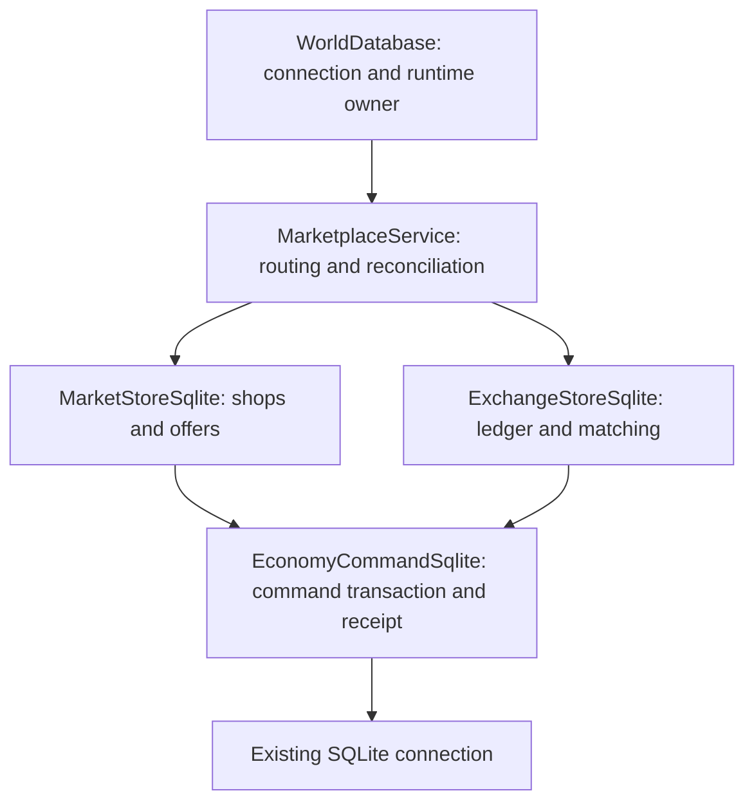

# Marketplace refactor: R3–R4

R0–R2 were accepted and merged locally into shop. This second batch is isolated
on codex/shop-r3-r4; R6 claims UX/native acceptance and Gateway session expiry
remain separate work. No schema or production wire/model changes.

## R3: application orchestration

WorldDatabase still owns SQLite, wallet/progression RAM, dirty checkpoints and
initial migrations. Its existing market_snapshot/market_command/market_query
methods delegate to one lazily-created MarketplaceService. The existing
market_account_changed signal forwards that service's account_changed fact, so
endpoints in all instances keep their existing subscription/publication contract.

MarketplaceService owns Shop/Exchange routing, the shared negative-response cache
and R2 global search budget, pending Yang collection and post-COMMIT reconciliation.
It uses the current WorldDatabase connection when constructing stores; it neither
owns/closes that connection nor creates another runtime wallet. Fresh COMMIT alone
accepts wallet totals and clears included deltas. Durable receipt replay returns
its existing result but never restores old wallet values or clears newer income.
Successful replay retains the prior authoritative snapshot refresh/publication
behavior; it does not represent a second economic mutation.

No new service-extraction unit suite: existing purchase/orders cases already test
SQL write faults, pending income, offline settlement, visible COMMIT before account
facts and newer RAM after replay. Existing search/load cases protect the shared
budget, and network cases cover actual bridge/RPC/subscription flows.

R3 passed purchase/orders/search SQLite contracts, market_network, market_race,
exchange_network, live combat+10k search load and WAL crash/backup/restore. The
shared budget still admitted 23 and rejected 697 searches; 360 physics traversals
and six accepted attacks/actual impacts were preserved in each six-second phase.
Loaded tick-interval p99 was 21.478 ms (local observation, no timing assertion).

## R4: shared command boundary by composition

Both stores extend RefCounted and compose their own EconomyCommandSqlite using the
same connection and the service's shared rejection cache. Exchange neither inherits
nor constructs a Shop store; its API covers ledger/reserves/orders/snapshots plus
an explicit receipt delegation. Domain statements stay in their respective stores.

The component contains the existing command ID validation, authenticated account
resolution, argument fingerprint, durable receipt replay/conflict, BEGIN IMMEDIATE,
rollback, rejection-cache handling and receipt+COMMIT. Its committed flag is true
only for a fresh successful transaction; both stores expose that existing marker
through a getter. There is no nested domain transaction, second connection or
post-COMMIT SQL read for runtime wallet acceptance. Read snapshots and initial
migration transactions retain their original store-specific handling.

Migration function bodies were compared with the R3 commit: MarketStore v19,
Exchange ledger v21 and orders v22 are unchanged. WorldSchema and MarketSearch
v20 migrations were not edited or moved. Matching order, rational arithmetic,
reservations, statement order and receipt kind/fingerprints are preserved.

No new tests were added merely for creating the service/component. The existing
fault-stage suites exercise the shared boundary through public Shop and Exchange
operations, including receipt-insert failure and whole-transaction rollback.
R6 claims UX and native/manual CEF acceptance remain deferred to the third batch.

R4 final verification passed: custody, purchase, ledger/orders and search suites;
market_network, market_race and exchange_network; WAL process-crash/backup/restore;
Yang, Web Inventory; architecture guards; ten Godot smoke cases and 78 Web
contracts. Windows client and Windows/Ubuntu server pack boundaries/boot passed.
No new implementation-unit suite was introduced for this extraction.

The live 10k-offer fixture still accepted 23 / rejected 697 searches, with 361
physics traversals and six accepted attacks/actual impacts in each phase. Loaded
physics-work p95/p99 11.756/16.602 ms; tick-interval p95/p99/max
20.712/22.974/25.801 ms. Single-read hitches remain possible; the R2 budget and
worker decision have not changed. FULL receipt commit p50/p95 0.523/0.654 ms.
These are local observations, not new performance assertions or production promises.

R3 and R4 are separate verified commits. This topic is not merged/published yet;
shop contains the accepted R0–R2 merge, main remains untouched. Existing runtime
servers were not restarted by these headless checks. Native CEF and claims/session
UX acceptance stays with R6.
